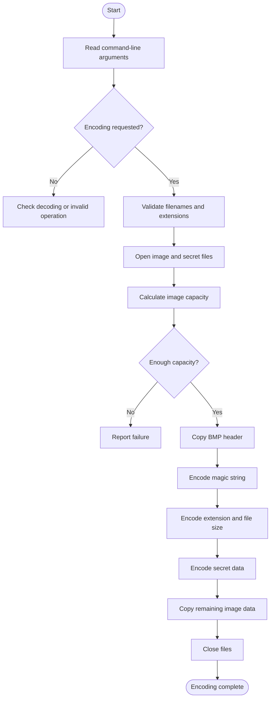
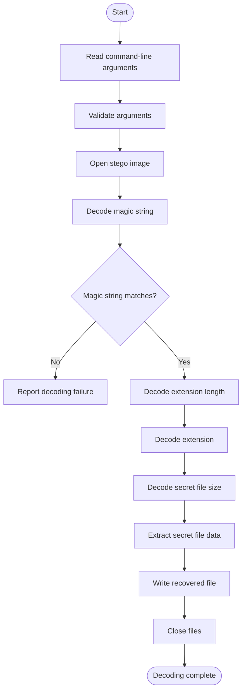

# 🔐 Image Steganography in C

### Hide Secret Data Inside BMP Images Using Least Significant Bit (LSB) Encoding

Image Steganography is a command-line application developed using the C programming language to hide secret file data inside BMP images and retrieve it when required.

The project implements **Least Significant Bit (LSB) steganography**, a technique that embeds secret information into the least significant bits of image bytes. It supports encoding and decoding operations, allowing users to hide a secret file inside a BMP image and recover it later.

This project demonstrates practical applications of C programming, binary file handling, bitwise operations, pointers, structures, command-line arguments, file management, and modular programming.

---

## 📌 Table of Contents

- [About the Project](#-about-the-project)
- [Objectives](#-objectives)
- [What Is Image Steganography?](#-what-is-image-steganography)
- [How LSB Steganography Works](#-how-lsb-steganography-works)
- [Project Features](#-project-features)
- [Encoding Process](#-encoding-process)
- [Decoding Process](#-decoding-process)
- [Hidden Data Structure](#-hidden-data-structure)
- [Project Structure](#-project-structure)
- [Technologies and Concepts](#-technologies-and-concepts)
- [Prerequisites](#-prerequisites)
- [Compilation](#-compilation)
- [Execution and Usage](#-execution-and-usage)
- [Sample Input and Output](#-sample-input-and-output)
- [Function Documentation](#-function-documentation)
- [Error Handling](#-error-handling)
- [Testing Scenarios](#-testing-scenarios)
- [Sample Files and Demonstration](#-sample-files-and-demonstration)
- [Limitations](#-limitations)
- [Learning Outcomes](#-learning-outcomes)
- [Future Enhancements](#-future-enhancements)
- [Author](#-author)
- [Connect With Me](#-connect-with-me)

---

## 🚀 About the Project

Digital images contain pixel data that can be used to store additional information. This project uses the data in a BMP image to conceal a secret file.

During encoding, the application reads the original BMP image and the secret file. It embeds a magic string, the secret file extension, the secret file size, and the secret file contents into selected image bytes.

During decoding, the application reads the stego image, verifies the magic string, extracts the stored metadata, and reconstructs the secret file.

The application uses separate source and header files to organize the main program, encoding logic, decoding logic, and shared definitions.

### Project Information

| Property | Details |
|---|---|
| Project Name | Image Steganography in C |
| Programming Language | C |
| Application Type | Command-line application |
| Image Format | BMP |
| Technique | Least Significant Bit (LSB) manipulation |
| Main Operations | Encoding and decoding |
| Magic String | `#*` |
| Sample Output | Stego image and recovered secret file |

## 🎯 Objectives

- Understand the fundamentals of image steganography.
- Hide secret file data inside BMP images.
- Retrieve hidden information through decoding.
- Implement LSB manipulation using bitwise operations.
- Process image and secret files in binary mode.
- Use a magic string to identify the expected hidden-data format.
- Calculate image capacity before encoding.
- Preserve the secret file extension and size.
- Apply pointers, arrays, structures, and functions.
- Develop a modular application using multiple C source and header files.
- Practice command-line argument processing and error handling.

## 🧠 What Is Image Steganography?

Image steganography is a technique for concealing information within another file, such as an image.

Unlike encryption, which transforms information into a different representation, steganography attempts to conceal the presence of the information itself.

In this project, a secret file is embedded into a BMP image by modifying selected least significant bits of image bytes.

The important terms are:

- **Cover Image:** The original BMP image used to carry the secret data.
- **Secret File:** The file that needs to be hidden.
- **Stego Image:** The output image containing the embedded data.
- **Encoding:** The process of embedding the secret file into the image.
- **Decoding:** The process of extracting the hidden file.
- **LSB:** The least significant bit of a byte.
- **Magic String:** A predefined identifier used to recognize the expected encoded data format.

## ⚙️ How LSB Steganography Works

A byte contains eight bits. The least significant bit is the rightmost bit.

For example:

```text
Original byte : 10110100
Secret bit    :        1
Modified byte : 10110101
```

Only the least significant bit changes in this example.

The encoder processes each secret byte one bit at a time. Each bit is stored in the least significant bit of one image byte.

Therefore, **one secret byte requires eight image bytes** for the payload encoding.

### Example: Encoding the Character `A`

```text
Character : A
ASCII     : 65
Binary    : 01000001
```

The eight binary bits are embedded into the least significant bits of eight image bytes.

During decoding, the program reads those bits and reconstructs the original byte.

The process continues until the stored secret file size has been recovered.

### Advantages of LSB Encoding

- Simple to understand and implement.
- Demonstrates practical bitwise manipulation.
- Supports embedding binary file data.
- Provides hands-on experience with image processing and file handling.

**Security note:** LSB steganography is not encryption. The hidden data may be detectable, and modifying or recompressing the image may damage the embedded information.

## ✨ Project Features

### 1. Encode Secret Data

Hides a secret file inside a BMP image using LSB manipulation.

### 2. Decode Hidden Data

Extracts the hidden file from an image previously generated by the encoder.

### 3. Magic String Verification

Uses the predefined magic string `#*` to identify the expected hidden-data format before continuing with extraction.

### 4. Secret File Extension Preservation

Stores the secret file extension so that the decoder can recover it and use it when generating the output file.

### 5. Secret File Size Storage

Stores the original secret file size, allowing the decoder to determine how many bytes to extract.

### 6. Image Capacity Checking

Calculates the image capacity and checks whether the image can hold the metadata and secret file data.

### 7. BMP Header Preservation

Copies the first 54 bytes of the source BMP image before embedding the hidden data.

### 8. Optional Output Filename

Allows the user to provide a custom filename for the output stego image.

### 9. Modular Programming

Separates the main program, encoding functions, decoding functions, and shared declarations into multiple files.

### 10. Command-Line Interface

Allows the user to choose encoding or decoding using command-line arguments.

## 🔐 Encoding Process

The encoding process follows these steps:

1. Read the command-line arguments.
2. Identify the encoding option `-e`.
3. Validate the source BMP filename and secret file extension.
4. Select the output stego image filename.
5. Open the required files in binary mode.
6. Calculate the source image capacity.
7. Determine the secret file size.
8. Check whether the image has enough capacity.
9. Copy the 54-byte BMP header.
10. Encode the magic string `#*`.
11. Encode the secret file extension length.
12. Encode the secret file extension.
13. Encode the secret file size.
14. Encode the secret file contents.
15. Copy the remaining image data.
16. Close the files and report the operation status.

### Encoding Flowchart



## 🔓 Decoding Process

The decoding process follows these steps:

1. Read the command-line arguments.
2. Identify the decoding option `-d`.
3. Validate the stego image filename and output filename.
4. Open the stego image.
5. Extract and verify the magic string.
6. Decode the secret file extension length.
7. Recover the secret file extension.
8. Decode the original secret file size.
9. Extract the secret file contents.
10. Write the recovered bytes to the output file.
11. Close the files and report the operation status.

### Decoding Flowchart



## 🧩 Hidden Data Structure

The encoder stores the following information in the image data.

| Order | Information | Storage Requirement |
|---|---|---|
| 1 | Magic string `#*` | 16 image bytes |
| 2 | Secret file extension length | 32 image bytes |
| 3 | Secret file extension | 8 image bytes per character |
| 4 | Secret file size | 32 image bytes |
| 5 | Secret file contents | 8 image bytes per secret byte |

The total storage required for the embedded information is:

```text
Total image bytes required =
    16
  + 32
  + (extension length × 8)
  + 32
  + (secret file size × 8)
```

This formula represents the image bytes required for the embedded payload, excluding the copied BMP header and any remaining image data.

The exact format depends on the matching encoding and decoding implementation.

## 📂 Project Structure

```text
Image-Steganography-in-C/
├── main.c
├── encode.c
├── encode.h
├── decode.c
├── decode.h
├── common.h
├── types.h
├── README.md
├── .gitignore
├── beautiful.bmp
├── stego_image.bmp
├── recovered_secret.txt
└── sample-output.txt
```

The tree above assumes the sample files are in the repository's root directory. If you placed them inside a folder such as `samples/`, update the tree to match your actual repository.

## 📄 File Descriptions

| File | Description |
|---|---|
| `main.c` | Entry point; processes command-line arguments and selects encoding or decoding |
| `encode.c` | Implements encoding and LSB manipulation |
| `encode.h` | Contains encoding-related structures and function declarations |
| `decode.c` | Implements magic string verification and secret data extraction |
| `decode.h` | Contains decoding-related structures and function declarations |
| `common.h` | Contains shared definitions, including the magic string where declared |
| `types.h` | Defines operation types, status values, and common data types |
| `beautiful.bmp` | Original BMP cover image |
| `stego_image.bmp` | Image containing the embedded secret data |
| `recovered_secret.txt` | Recovered secret file generated during decoding |
| `sample-output.txt` | Optional file containing sample terminal output |
| `.gitignore` | Excludes configured generated files and local files from Git tracking |
| `README.md` | Project documentation |

## 🛠️ Technologies and Concepts

### Programming Language

**C Programming**

### Concepts Applied

| Concept | Application |
|---|---|
| Structures | Store encoding and decoding information |
| Enumerations | Represent operation types and status values |
| Pointers | Pass file handles, buffers, and structures |
| Arrays | Store image bytes and metadata |
| String Handling | Process filenames and file extensions |
| Command-Line Arguments | Select operations and provide filenames |
| Binary File Handling | Read and write BMP and secret files |
| Bitwise Operations | Extract and embed individual bits |
| File Positioning | Navigate through file contents |
| Modular Programming | Organize code into multiple source and header files |
| Error Handling | Detect invalid arguments and file errors |

### Important C Library Functions

- `fopen()` — Opens a file.
- `fread()` — Reads binary data.
- `fwrite()` — Writes binary data.
- `fseek()` — Changes the file position.
- `ftell()` — Returns the current file position.
- `rewind()` — Resets the file position.
- `fclose()` — Closes a file.
- `strlen()` — Calculates a string's length.
- `strcmp()` — Compares strings.
- `strstr()` — Searches for a substring.
- `strrchr()` — Finds the last occurrence of a character.
- `printf()` — Displays output.
- `perror()` — Displays an error message associated with a system error.

## 💻 Prerequisites

Before running the project, you need:

- GCC or another compatible C compiler.
- A terminal or command prompt.
- A compatible BMP image.
- A secret file, such as a `.txt` file.
- Sufficient image capacity for the secret file and metadata.

The implementation assumes a 54-byte BMP header and calculates image capacity using three bytes per pixel. Use a compatible BMP image for testing.

## ⚙️ Compilation

### Linux

Open a terminal in the project directory and run:

```bash
gcc main.c encode.c decode.c -o a.out
```

### Windows with GCC

```bash
gcc main.c encode.c decode.c -o steganography.exe
```

If compilation succeeds, the executable is created in the current directory.

## ▶️ Execution and Usage

The program supports two primary operations:

- `-e` — Encode secret data into a BMP image.
- `-d` — Decode secret data from a stego image.

### 1. Encoding

**Syntax:**

```bash
./a.out -e <source.bmp> <secret_file> [stego_image.bmp]
```

**Example:**

```bash
./a.out -e beautiful.bmp secret.txt stego_image.bmp
```

Here:

- `beautiful.bmp` is the original cover image.
- `secret.txt` is the file to hide.
- `stego_image.bmp` is the output image containing the hidden data.

The output image filename is optional. If omitted, the program uses its default output filename, `stego_image.bmp`.

**Example with the default output filename:**

```bash
./a.out -e beautiful.bmp secret.txt
```

### 2. Decoding

**Syntax:**

```bash
./a.out -d <stego_image.bmp> [recovered_secret.txt]
```

**Example:**

```bash
./a.out -d stego_image.bmp recovered_secret.txt
```

Here:

- `stego_image.bmp` is the image containing the embedded data.
- `recovered_secret.txt` is the requested output filename for the recovered data.

The optional output filename and its default behavior depend on the implementation in `main.c` and `decode.c`.

### Windows Execution

Compile:

```bash
gcc main.c encode.c decode.c -o steganography.exe
```

Encode:

```bash
steganography.exe -e beautiful.bmp secret.txt stego_image.bmp
```

Decode:

```bash
steganography.exe -d stego_image.bmp recovered_secret.txt
```

Replace the example filenames with the files available in your project directory.

## 🧪 Sample Input and Output

The following examples illustrate the expected workflow. Exact output depends on the source image, secret file, and messages printed by your implementation.

### Example 1: Encoding

**Command:**

```bash
./a.out -e beautiful.bmp secret.txt stego_image.bmp
```

**Illustrative output:**

```text
INFO: Operation type is Encode
INFO: Arguments are valid for encoding
width = 1024
height = 768
INFO: Encoding successful
```

The program identifies the encoding operation, validates its arguments, checks the image capacity, and attempts to generate the stego image.

### Example 2: Decoding

**Command:**

```bash
./a.out -d stego_image.bmp recovered_secret.txt
```

**Illustrative output:**

```text
INFO: Operation type is Decode
INFO: Arguments are valid for decoding
INFO: Decoding successful
```

The decoder verifies the magic string and attempts to extract the embedded secret file.

### Example 3: Recovered Secret File

The following is an example of secret text that can be used for testing:

```text
SARDAR: CODE RED

At 03:33 AM, the security cameras went offline.
No alarms. No forced entry.

One message appeared on the screen:

"WE KNOW YOU ARE HERE."

The system shut down. All records were erased.

Do not trust the terminal. Do not open unknown files.

CODE RED ACTIVE.

FINAL WARNING: YOU ARE BEING WATCHED.
```

After decoding, compare the recovered file with the original to confirm that the data has been preserved.

**Note:** The example text is illustrative. It should only be described as your actual test output if it matches the file you uploaded.

## 🧾 Function Documentation

The functions below describe the project's expected module responsibilities. Verify exact function names against your source files before treating this section as a complete API reference.

### Main Program — `main.c`

**`main()`**

- Entry point of the application.
- Processes command-line arguments.
- Selects encoding or decoding.
- Calls the corresponding operation.
- Reports operation status.

**`check_operation_type()`**

Identifies the requested operation from the command-line option, returning the corresponding operation type for encoding, decoding, or an unsupported option.

### Encoding Module — `encode.c`

**`read_and_validate_encode_args()`**

Validates encoding arguments and stores the relevant filenames.

**`open_files()`**

Opens the source BMP image, secret file, and destination image.

**`get_image_size_for_bmp()`**

Reads image dimensions from the BMP header and calculates the capacity using the implementation's supported image layout.

**`get_file_size()`**

Determines the size of the secret file using file-positioning operations.

**`check_capacity()`**

Checks whether the image can hold the hidden metadata and secret file contents.

**`copy_bmp_header()`**

Copies the BMP header from the original image to the output image.

**`encode_magic_string()`**

Embeds the predefined magic string in the image bytes.

**`encode_secret_file_extn_size()`**

Embeds the length of the secret file extension.

**`encode_secret_file_extn()`**

Embeds the secret file extension.

**`encode_secret_file_size()`**

Embeds the original secret file size.

**`encode_secret_file_data()`**

Reads the secret file and embeds its contents into the image.

**`encode_byte_to_lsb()`**

Embeds one byte into the least significant bits of image bytes.

**`encode_size_to_lsb()`**

Embeds an integer size value into image bytes.

**`copy_remaining_img_data()`**

Copies the remaining source image data after the encoded payload.

**`do_encoding()`**

Coordinates the encoding workflow.

### Decoding Module — `decode.c`

**`read_and_validate_decode_args()`**

Validates the decoding arguments and stores the relevant filenames.

**`open_decode_files()`**

Opens the stego image and output file.

**`check_magic_string()`**

Extracts and verifies the expected magic string.

**`decode_secret_file_extn_size()`**

Extracts the secret file extension length.

**`decode_secret_file_extn()`**

Recovers the stored file extension.

**`decode_secret_file_size()`**

Recovers the original secret file size.

**`decode_byte_from_lsb()`**

Reconstructs a byte from the least significant bits of image bytes.

**`decode_size_from_lsb()`**

Reconstructs an integer from the embedded size bits.

**`decode_secret_file_data()`**

Extracts the hidden file contents and writes them to the output file.

**`do_decoding()`**

Coordinates the decoding workflow.

### Shared Definitions

**`Status`**

Represents the success or failure status of an operation.

**`OperationType`**

Represents the selected encoding, decoding, or unsupported operation.

**`EncodeInfo`**

Stores encoding-related file information and operation state.

**`DecodeInfo`**

Stores decoding-related file information and operation state.

**`MAGIC_STRING`**

The predefined identifier `#*` used to verify the expected hidden-data format.

## ⚠️ Error Handling

The implementation checks various conditions during encoding and decoding.

| Condition | Expected behavior |
|---|---|
| Missing command-line arguments | Reports an argument or usage error |
| Unsupported operation | Reports an unsupported operation |
| Invalid filename or extension | Rejects invalid arguments |
| Source image cannot be opened | Reports a file-opening error |
| Secret file cannot be opened | Reports a file-opening error |
| Destination file cannot be created | Reports a file-opening error |
| Insufficient image capacity | Encoding fails |
| Magic string mismatch | Decoding fails |
| File read or write failure | The operation may fail |
| Successful operation | Reports completion |

The exact message depends on the failure point in the source code. The project does not necessarily validate every possible malformed BMP file.

## 🧪 Testing Scenarios

| Test Case | Input | Expected Result |
|---|---|---|
| Valid encoding | Compatible BMP and secret file | Stego image is generated |
| Valid decoding | Encoded image | Secret file is recovered |
| Missing arguments | Incomplete command | Argument validation fails |
| Unsupported option | Invalid command-line option | Unsupported operation is reported |
| Missing BMP image | Nonexistent filename | File-opening error |
| Missing secret file | Nonexistent secret filename | File-opening error |
| Insufficient capacity | Secret file too large | Encoding fails |
| Invalid magic string | Ordinary or incompatible BMP | Decoding fails |
| Content comparison | Original and recovered files | Contents match after successful recovery |

## 🖼️ Sample Files and Demonstration

The repository includes sample files to demonstrate the encoding and decoding workflow.

- **`beautiful.bmp`** — Original BMP cover image used for encoding.
- **`stego_image.bmp`** — Output BMP image containing the embedded secret data.
- **`recovered_secret.txt`** — Sample recovered file generated during decoding.

### Demonstration Workflow

1. Select the original BMP image and secret file.
2. Encode the secret file into the image.
3. Generate the stego image.
4. Decode the stego image.
5. Recover the secret file.
6. Compare the recovered file with the original file.

This demonstrates the intended workflow of the application.

## ⚠️ Limitations

- The implementation assumes a 54-byte BMP header.
- Image capacity is calculated using three bytes per pixel.
- The implementation recognizes the predefined magic string `#*`.
- The decoder expects the metadata layout generated by the encoder.
- The implementation does not encrypt the secret data.
- LSB modifications can be detected by steganalysis.
- Resizing, recompressing, or modifying the stego image may corrupt hidden data.
- The code does not validate every possible BMP format or malformed image.
- The implementation should be tested using compatible BMP images and secret files within the supported capacity.

## 📚 Learning Outcomes

Developing this project provided practical experience with:

- Understanding LSB-based steganography.
- Reading BMP headers and binary data.
- Embedding and extracting individual bits.
- Using bitwise operators such as `&`, `|`, `~`, `>>`, and `<<`.
- Working with arrays, pointers, and structures.
- Managing file pointers and binary file operations.
- Processing command-line arguments.
- Organizing code into multiple `.c` and `.h` files.
- Calculating image storage capacity.
- Designing encoding and decoding workflows.
- Implementing basic validation and error handling.
- Testing data recovery and file integrity.

## 🔮 Future Enhancements

Possible improvements include:

- Supporting additional BMP formats and pixel layouts.
- Strengthening validation of image headers and file boundaries.
- Improving error handling and resource cleanup.
- Adding automated encoding and decoding tests.
- Verifying recovered files against the originals.
- Supporting more secret file formats.
- Improving recovery when file writing fails.
- Adding optional encryption before embedding.
- Improving command-line help and documentation.

These are possible future improvements, not claims about features already implemented.

## 👨‍💻 Author

**Ajay Uppalapati**

Electronics and Communication Engineering graduate interested in C Programming, Embedded Systems, Linux, and software development.

This project is part of my hands-on programming journey, applying C concepts to a practical application involving binary data, file handling, and bitwise operations.

## 🔗 Connect With Me

- **GitHub:** [uppalapati-Ajay](https://github.com/uppalapati-Ajay)
- **LinkedIn:** [Connect with me on LinkedIn](https://www.linkedin.com/in/ajay-uppalapati-06865124b)

---

⭐ If you find this project interesting, feel free to explore the source code and share your feedback.

**Thank you for visiting my Image Steganography project!**
