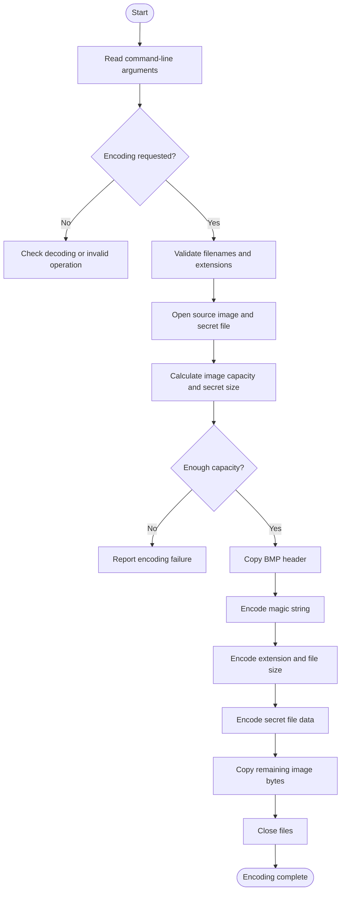
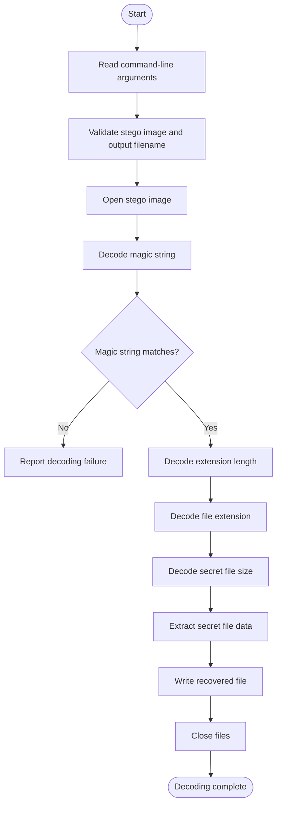

# 🔐 Image Steganography in C

### Hide Secret Data Inside BMP Images Using Least Significant Bit (LSB) Encoding

**Image Steganography in C** is a command-line application that hides a secret file inside a BMP image and retrieves it later without directly displaying the hidden information in the image.

The project implements **Least Significant Bit (LSB) steganography**, a technique that stores secret information in the least significant bits of image bytes. It supports both encoding and decoding operations, allowing users to embed a secret file into an image and recover it from the resulting stego image.

Developed using the C programming language, this project demonstrates practical applications of binary file handling, bitwise operations, pointers, structures, command-line arguments, modular programming, and error handling.

---

## 📌 Table of Contents

- [About the Project](#-about-the-project)
- [Objectives](#-objectives)
- [What Is Image Steganography?](#-what-is-image-steganography)
- [How LSB Steganography Works](#-how-lsb-steganography-works)
- [Project Features](#-project-features)
- [Encoding Process](#-encoding-process)
- [Decoding Process](#-decoding-process)
- [Hidden Data Structure](#-hidden-data-structure)
- [Project Structure](#-project-structure)
- [Technologies and Concepts](#-technologies-and-concepts)
- [Prerequisites](#-prerequisites)
- [Compilation](#-compilation)
- [Execution and Usage](#-execution-and-usage)
- [Sample Input and Output](#-sample-input-and-output)
- [Function Documentation](#-function-documentation)
- [Error Handling](#-error-handling)
- [Testing Scenarios](#-testing-scenarios)
- [Limitations](#-limitations)
- [Learning Outcomes](#-learning-outcomes)
- [Future Enhancements](#-future-enhancements)
- [Author](#-author)
- [Connect With Me](#-connect-with-me)

---

## 🚀 About the Project

Digital images contain large amounts of pixel data. This project uses that data to store secret file information within a BMP image.

The application takes three main inputs during encoding:

1. A source BMP image.
2. A secret file containing the information to hide.
3. An optional output filename for the resulting stego image.

During encoding, the program copies the BMP header and embeds the secret information into the least significant bits of image bytes. It stores a predefined magic string, the secret file extension, the extension length, the secret file size, and the secret file contents.

During decoding, the application reads the stego image, verifies the magic string, extracts the stored file information, and reconstructs the secret file.

The implementation is divided into separate source and header files to keep encoding, decoding, shared data types, and the main program organized.

### Project Information

| Item | Details |
|---|---|
| Project Name | Image Steganography in C |
| Programming Language | C |
| Application Type | Command-line application |
| Input Image Format | BMP |
| Technique | Least Significant Bit (LSB) manipulation |
| Main Operations | Encoding and Decoding |
| Magic String | `#*` |
| Output | Stego image and recovered secret file |

## 🎯 Objectives

- Understand how image steganography works.
- Implement LSB-based data hiding in BMP images.
- Encode secret file information into image bytes.
- Decode and recover the original secret file.
- Implement bitwise operations for individual bits.
- Perform binary file operations using standard C library functions.
- Use a magic string to identify an encoded image.
- Validate command-line arguments and file extensions.
- Organize the project using modular programming.
- Apply structures, pointers, arrays, and functions in a practical application.

## 🧠 What Is Image Steganography?

Image steganography is a technique used to conceal information inside an image so that the presence of the information is less apparent.

Unlike encryption, which transforms information into an unreadable form, steganography focuses on concealing the existence of the information within another file.

In this project, a secret file is embedded inside a BMP image. The program modifies selected least significant bits of image bytes to represent the secret information.

The output image is called a **stego image**.

### Important Terms

- **Cover Image:** The original BMP image used to store secret data.
- **Secret File:** The file that needs to be hidden.
- **Stego Image:** The BMP image containing the embedded secret information.
- **Encoding:** The process of embedding the secret file into the image.
- **Decoding:** The process of extracting the hidden file.
- **LSB:** The least significant bit of a byte.
- **Magic String:** A predefined identifier used to determine whether the expected hidden-data format is present.

## ⚙️ How LSB Steganography Works

A byte contains eight bits. The least significant bit is the rightmost bit.

For example:

```text
Original byte:  10110100
Secret bit:             1
Modified byte:  10110101
```

Only the least significant bit changes in this example.

The program processes each secret data byte one bit at a time. Each bit is stored in the least significant bit of one image byte.

Therefore, **one secret byte requires eight image bytes**.

### Example: Encoding the Character `A`

The ASCII representation of `A` is:

```text
Character: A
ASCII:     65
Binary:    01000001
```

The eight bits are embedded into the least significant bits of eight image bytes.

```text
Secret bits:
0 1 0 0 0 0 0 1

Image byte LSBs:
0 1 0 0 0 0 0 1
```

During decoding, the program extracts these bits and reconstructs the original byte.

This process is repeated for the secret file data.

### Why Use LSB?

- It is relatively simple to implement.
- It demonstrates practical bitwise manipulation.
- It allows data to be embedded directly into image bytes.
- It provides a useful learning example for binary file processing.

The project is an educational implementation of steganography. LSB hiding is not encryption and does not, by itself, provide strong confidentiality or protection against detection.

## ✨ Project Features

### 🔹 1. Encode Secret Data

Hide a secret file inside a BMP image using LSB manipulation.

### 🔹 2. Decode Hidden Data

Extract the embedded secret file from a previously encoded BMP image.

### 🔹 3. Magic String Verification

The program uses the magic string `#*` to identify the expected encoded data format before extracting the remaining information.

### 🔹 4. File Extension Preservation

The program embeds the secret file extension so that decoding can recover the extension and use it when saving the output file.

### 🔹 5. Secret File Size Storage

The original secret file size is embedded in the image, allowing the decoder to determine how many bytes to recover.

### 🔹 6. Image Capacity Checking

The encoding process calculates the image capacity and compares it with the amount of data that needs to be embedded.

### 🔹 7. BMP Header Preservation

The program copies the first 54 bytes of the source BMP file into the output image before encoding the hidden information.

### 🔹 8. Optional Output Filename

The encoding command accepts an optional output image filename. If it is omitted, the program uses `stego_image.bmp`.

### 🔹 9. Modular Design

The implementation separates the main program, encoding logic, decoding logic, shared structures, and function declarations.

### 🔹 10. Command-Line Interface

The user selects the required operation through command-line arguments instead of an interactive graphical interface.

## 🔐 Encoding Process

The encoding operation follows these steps:

1. Read the command-line arguments.
2. Identify the encoding operation using `-e`.
3. Validate the source BMP filename and secret file extension.
4. Select the output stego image filename.
5. Open the source image, secret file, and destination image.
6. Calculate the source image capacity.
7. Calculate the secret file size.
8. Verify that the image has sufficient capacity.
9. Copy the 54-byte BMP header.
10. Encode the magic string `#*`.
11. Encode the secret file extension length.
12. Encode the secret file extension.
13. Encode the secret file size.
14. Encode the secret file data byte by byte.
15. Copy the remaining image data.
16. Close the files and report the operation status.

### Encoding Flowchart



## 🔓 Decoding Process

The decoding operation follows these steps:

1. Read the command-line arguments.
2. Identify the decoding operation using `-d`.
3. Validate the stego image filename and optional output filename.
4. Open the stego image.
5. Read the hidden magic string.
6. Verify the magic string.
7. Decode the secret file extension length.
8. Decode the secret file extension.
9. Decode the original secret file size.
10. Extract the secret file data.
11. Write the recovered bytes into the output file.
12. Close the files and report the operation status.

### Decoding Flowchart



## 🧩 Hidden Data Structure

The encoding process stores the following information in the image data:

| Order | Information | Storage |
|---|---|---|
| 1 | Magic string `#*` | 2 characters, 16 image bytes |
| 2 | Secret file extension length | 32 bits, 32 image bytes |
| 3 | Secret file extension | 8 image bytes per character |
| 4 | Secret file size | 32 bits, 32 image bytes |
| 5 | Secret file contents | 8 image bytes per secret byte |

For the implementation's expected extension length, the required number of image bytes can be calculated as:

```text
Total image bytes required =
    16
  + 32
  + (extension length × 8)
  + 32
  + (secret file size × 8)
```

This calculation represents the data embedded after the BMP header. The encoding function checks the available capacity before proceeding.

## 📂 Project Structure

Image-Steganography-in-C/
│
├── main.c
├── encode.c
├── encode.h
├── decode.c
├── decode.h
├── common.h
├── types.h
├── README.md
├── .gitignore
│
├── samples/
│   ├── beautiful.bmp
│   ├── stego_image.bmp
│   └── recovered_secret.txt
│
└── docs/
    └── sample-output.txt

### File Descriptions

| File | Responsibility |
|---|---|
| `main.c` | Entry point, operation selection, argument processing, and calling encoding or decoding |
| `encode.c` | Encoding functions, capacity checking, BMP header copying, and LSB data embedding |
| `encode.h` | `EncodeInfo` structure and encoding function declarations |
| `decode.c` | Decoding functions, magic string verification, and secret file extraction |
| `decode.h` | `DecodeInfo` structure and decoding function declarations |
| `common.h` | Shared definitions, including the magic string, where defined by the project |
| `types.h` | `Status` and `OperationType` enumerations and the `uint` type |
| `README.md` | Project documentation |
| `.gitignore` | Rules for excluding configured generated and local files |

## 🛠️ Technologies and Concepts

### Programming Language

**C Programming**

The project uses C to process binary files, manipulate bits, manage memory buffers, and organize operations into functions.

### Concepts Applied

| Concept | Application |
|---|---|
| Structures | `EncodeInfo` and `DecodeInfo` store operation and file information |
| Enumerations | `Status` and `OperationType` represent operation states |
| Pointers | File pointers, buffers, and structures are passed to functions |
| Arrays | Store BMP headers, byte buffers, and file extensions |
| String Handling | Validate extensions, compare arguments, and process filenames |
| Command-Line Arguments | Select encoding or decoding and provide filenames |
| Binary File Handling | Read and write image and secret file bytes |
| Bitwise Operations | Extract and embed individual bits |
| File Positioning | Use `fseek()`, `ftell()`, and `rewind()` |
| Modular Programming | Separate implementation into `.c` and `.h` files |
| Error Handling | Check argument validity, file opening, capacity, and operation status |

### Important C Library Functions

- `fopen()` — Opens a file.
- `fread()` — Reads data from a file.
- `fwrite()` — Writes data to a file.
- `fseek()` — Changes the file position.
- `ftell()` — Returns the current file position.
- `rewind()` — Moves the file position to the beginning.
- `fclose()` — Closes a file.
- `strlen()` — Calculates a string's length.
- `strstr()` — Searches for a substring.
- `strrchr()` — Finds the last occurrence of a character.
- `strcmp()` — Compares strings.
- `strcpy()` — Copies a string.
- `printf()` — Displays information.
- `perror()` — Displays an error message associated with the current system error.

## 💻 Prerequisites

Before running the project, ensure you have:

- GCC or another compatible C compiler.
- A terminal or command prompt.
- A BMP image suitable for embedding data.
- A secret file, such as a `.txt` file.
- Sufficient image capacity for the secret file.

The implementation assumes a BMP layout with a 54-byte header and calculates image capacity using three bytes per pixel. Use a compatible BMP image for testing.

## ⚙️ Compilation

### Linux

Open a terminal in the project directory and run:

```bash
gcc main.c encode.c decode.c -o a.out
```

This compiles the main program and both encoding and decoding modules into one executable.

### Windows with GCC

```bash
gcc main.c encode.c decode.c -o steganography.exe
```

If compilation succeeds, the executable will be created in the current directory.

## ▶️ Execution and Usage

The program supports two primary operations:

- `-e` — Encode a secret file into a BMP image.
- `-d` — Decode a secret file from a stego image.

### 1. Encoding

**Syntax:**

```bash
./a.out -e <source.bmp> <secret_file> [stego_image.bmp]
```

**Example:**

```bash
./a.out -e beautiful.bmp secret.txt stego_image.bmp
```

Here:

- `beautiful.bmp` is the source BMP image.
- `secret.txt` is the file to hide.
- `stego_image.bmp` is the output image containing the hidden data.

The output filename is optional. If it is omitted, the program uses `stego_image.bmp`.

**Example with the default output filename:**

```bash
./a.out -e beautiful.bmp secret.txt
```

### 2. Decoding

**Syntax:**

```bash
./a.out -d <stego_image.bmp> [recovered_secret.txt]
```

**Example:**

```bash
./a.out -d stego_image.bmp recovered_secret.txt
```

Here:

- `stego_image.bmp` is the previously encoded image.
- `recovered_secret.txt` is the requested output filename for the recovered data.

The output filename is optional according to the program's command-line usage. If omitted, the program uses its built-in default output naming behavior.

### Windows Execution

Compile the project:

```bash
gcc main.c encode.c decode.c -o steganography.exe
```

Encode:

```bash
steganography.exe -e beautiful.bmp secret.txt stego_image.bmp
```

Decode:

```bash
steganography.exe -d stego_image.bmp recovered_secret.txt
```

**Important:** Use the actual filenames available in your project directory. The source BMP image and secret file must exist before encoding.

## 🧪 Sample Input and Output

The following examples are based on the sample execution documented with the project. The image dimensions and metadata are illustrative sample values, not guaranteed results for every image.

### Example 1: Encoding a Secret File

**Command:**

```bash
./a.out -e beautiful.bmp secret.txt stego_image.bmp
```

**Sample output:**

```text
INFO: Operation type is Encode
INFO: Arguments are valid for encoding
width = 1024
height = 768
INFO: Encoding successful
```

This indicates that the operation was identified as encoding, the command-line arguments were accepted, the image dimensions were read, and the encoding function returned success.

### Example 2: Decoding the Hidden File

**Command:**

```bash
./a.out -d stego_image.bmp recovered_secret.txt
```

**Sample output:**

```text
INFO: Operation type is Decode
INFO: Arguments are valid for decoding
INFO: Decoding successful
```

The decoder attempts to verify the magic string and recover the stored file extension, file size, and file contents.

### Example 3: Recovered Secret File

The following text is the sample secret content documented with the project:

```text
SARDAR: CODE RED

At 03:33 AM, the security cameras went offline.
No alarms. No forced entry.

One message appeared on the screen:

"WE KNOW YOU ARE HERE."

The system shut down. All records were erased.

Do not trust the terminal. Do not open unknown files.

CODE RED ACTIVE.

FINAL WARNING: YOU ARE BEING WATCHED.
```

After successful decoding, compare the recovered file with the original secret file to verify that the content has been preserved.

## 🧾 Function Documentation

The project is divided into encoding, decoding, and shared operations.

### Main Program — `main.c`

**`main()`**

- Entry point of the application.
- Checks whether command-line arguments are supplied.
- Identifies the requested operation.
- Validates encoding or decoding arguments.
- Calls `do_encoding()` or `do_decoding()`.
- Reports operation status and returns an appropriate exit status.

**`check_operation_type()`**

- Checks the operation option.
- Returns `e_encode` for `-e`.
- Returns `e_decode` for `-d`.
- Returns `e_unsupported` for an unsupported option.

### Encoding Functions — `encode.c`

**`read_and_validate_encode_args()`**

Validates the source BMP filename, secret filename, optional output image filename, and secret file extension. It stores the selected filenames in `EncodeInfo`.

---

**`open_files()`**

Opens the source image in binary read mode, the secret file in binary read mode, and the destination stego image in binary write mode.

---

**`get_image_size_for_bmp()`**

Reads the BMP width and height from their expected header offsets and calculates image capacity using three bytes per pixel.

---

**`get_file_size()`**

Moves the secret file pointer to the end, obtains the file size using `ftell()`, and resets the pointer to the beginning.

---

**`check_capacity()`**

Calculates the source image capacity and secret file size. It verifies whether the image can hold the magic string, extension length, extension, secret file size, and secret file data.

---

**`copy_bmp_header()`**

Copies the first 54 bytes of the source BMP image to the destination image.

---

**`encode_magic_string()`**

Embeds the predefined magic string into the least significant bits of image bytes.

---

**`encode_secret_file_extn_size()`**

Embeds the length of the secret file extension using 32 image bytes.

---

**`encode_secret_file_extn()`**

Embeds the secret file extension into image bytes, processing one character at a time.

---

**`encode_secret_file_size()`**

Embeds the secret file size into 32 image bytes.

---

**`encode_secret_file_data()`**

Reads secret file bytes and embeds each byte into the LSBs of eight image bytes. It checks the results of the secret file read, image buffer read, and destination write operations.

---

**`encode_byte_to_lsb()`**

Extracts eight bits from a secret character and stores them in the least significant bits of eight image bytes.

---

**`encode_size_to_lsb()`**

Encodes a 32-bit integer into the least significant bits of 32 image bytes.

---

**`copy_remaining_img_data()`**

Copies the remaining source image bytes to the destination image after the hidden information has been embedded.

---

**`do_encoding()`**

Coordinates the encoding process by opening files, checking capacity, copying the BMP header, embedding the required information, copying the remaining image data, and closing the files.

### Decoding Functions — `decode.c`

**`read_and_validate_decode_args()`**

Validates the decoding command-line arguments and stores the stego image filename and output filename in `DecodeInfo`.

---

**`open_decode_files()`**

Opens the stego image and the output file needed for decoding.

---

**`check_magic_string()`**

Extracts the magic string from the image and compares it with the expected value to check whether the image contains the expected hidden-data format.

---

**`decode_secret_file_extn_size()`**

Extracts the stored extension length from the least significant bits of image bytes.

---

**`decode_secret_file_extn()`**

Recovers the secret file extension from the encoded image.

---

**`decode_secret_file_size()`**

Extracts the original secret file size from the image.

---

**`decode_byte_from_lsb()`**

Reads the least significant bits of eight image bytes and reconstructs one character.

---

**`decode_size_from_lsb()`**

Reconstructs an integer from the least significant bits of 32 image bytes.

---

**`decode_secret_file_data()`**

Extracts the hidden secret file bytes and writes them to the output file.

---

**`do_decoding()`**

Coordinates the decoding process by opening files, verifying the magic string, recovering the extension and file size, extracting the secret file data, and closing the files.

### Shared Types and Structures

**`Status`**

Represents operation results using `e_success` and `e_failure`.

**`OperationType`**

Represents the requested operation using `e_encode`, `e_decode`, and `e_unsupported`.

**`EncodeInfo`**

Stores encoding-related filenames, file pointers, image capacity, secret file extension, and secret file size.

**`DecodeInfo`**

Stores decoding-related filenames, file pointers, recovered file extension, and secret file size.

**`MAGIC_STRING`**

The predefined string `#*`, used by the encoder and decoder to identify the expected embedded-data format.

## ⚠️ Error Handling

The application checks several error conditions during execution.

| Condition | Expected behavior |
|---|---|
| Missing command-line arguments | Reports missing arguments |
| Unsupported operation option | Reports an unsupported operation |
| Invalid source image filename | Rejects invalid encoding arguments |
| Secret filename without an extension | Rejects invalid secret file arguments |
| Invalid output image extension | Rejects invalid encoding arguments |
| Source image cannot be opened | Reports a file-opening error |
| Secret file cannot be opened | Reports a file-opening error |
| Destination image cannot be opened | Reports a file-opening error |
| Insufficient image capacity | Encoding fails |
| Invalid or missing magic string | Decoding fails |
| Secret metadata or data cannot be read | The corresponding operation may fail |
| Successful encoding or decoding | Reports success |

The exact message depends on the failure point in the implementation. The project checks important file and argument conditions, but it is not a complete validator for every possible malformed BMP image.

## 🧪 Testing Scenarios

Use the following scenarios to evaluate the project:

| Test | Input | Expected result |
|---|---|---|
| Valid encoding | Compatible BMP and existing secret file | Stego image is generated |
| Valid decoding | Correctly encoded image | Secret file is recovered |
| Missing arguments | Incomplete command | Usage or argument error |
| Invalid operation | Unsupported option | Unsupported operation message |
| Missing source image | Nonexistent BMP filename | File-opening failure |
| Missing secret file | Nonexistent secret filename | File-opening failure |
| Insufficient capacity | Secret data too large for the image | Encoding failure |
| Image without the expected magic string | Ordinary BMP image | Decoding should fail |
| Incorrect output extension | Invalid stego image filename | Argument validation failure |
| Content comparison | Original and recovered secret files | Contents should match after successful encoding and decoding |

## ⚠️ Limitations

This project is an educational implementation of BMP image steganography. Its current implementation has several limitations:

- It assumes a 54-byte BMP header.
- It calculates image capacity using three bytes per pixel.
- It recognizes the predefined `#*` magic string.
- It supports the specific secret file metadata and frame layout implemented in the source code.
- The encoder and decoder rely on matching bit order and metadata layout.
- The implementation does not encrypt the secret file.
- LSB modifications may be detectable through steganalysis.
- Resizing, recompressing, or otherwise modifying the stego image may corrupt the embedded data.
- The code does not fully validate every BMP variant, malformed image, or unexpected file size.
- The implementation should be tested with compatible BMP files and secret files within the supported capacity.

## 📚 Learning Outcomes

Developing this project helped me apply core C programming concepts to a practical file-processing application.

### Technical Learning

- Understanding LSB-based steganography.
- Working with BMP image headers and binary data.
- Extracting and embedding individual bits.
- Applying bitwise operators such as `&`, `|`, `~`, `>>`, and `<<`.
- Using arrays and pointers to process byte buffers.
- Managing file pointers and file positions.
- Reading and writing binary files.
- Handling command-line arguments.
- Using structures and enumerations.
- Organizing code into multiple source and header files.
- Implementing encoding and decoding workflows.
- Handling invalid arguments and file-opening errors.

### Problem-Solving Skills

- Calculating the storage capacity required for hidden information.
- Designing a metadata layout that the decoder can interpret.
- Preserving the original BMP header.
- Separating encoding logic from decoding logic.
- Tracking data sizes and file positions during binary processing.
- Testing whether recovered data matches the original file.

## 🔮 Future Enhancements

Possible future improvements include:

- Support for additional BMP formats and pixel layouts.
- Stronger validation of image dimensions and file boundaries.
- More comprehensive error handling and cleanup.
- Improved support for larger secret files.
- Automated tests for encoding and decoding.
- Verification that recovered file contents match the original.
- Safer handling of interrupted writes and output-file failures.
- Optional encryption of the secret file before embedding.
- Support for additional secret file formats.
- Improved documentation and command-line help.

These are proposed improvements and are not claims about the current implementation.

## 👨‍💻 Author

**Ajay Uppalapati**

Electronics and Communication Engineering graduate interested in C Programming, Embedded Systems, Linux, and software development.

This project is part of my hands-on programming journey, where I apply C concepts to practical problems involving binary data, file handling, and bitwise operations.

## 🔗 Connect With Me

- **GitHub:** [uppalapati-Ajay](https://github.com/uppalapati-Ajay)
- 
- **LinkedIn:** [Connect with me on LinkedIn](www.linkedin.com/in/ajay-uppalapati-06865124b)


---

⭐ If you find this project interesting, feel free to explore the source code and share your feedback.

**Thank you for visiting my Image Steganography project!**
